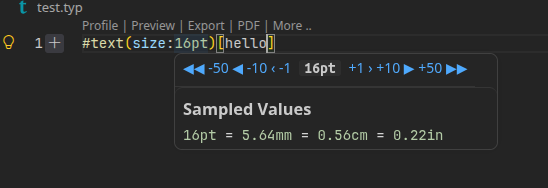

# Inline number slider

Interactive mini-slider for vscode units (instead of modifying it by yourself)

- **Support:**
  - **Typst:** `pt`, `em`, `%`, `mm`, `cm`, `in`, `deg`, `rad`
  - **CSS / Web:** `px`, `rem`, `em`, `%`, `vh`, `vw`, `vmin`, `vmax`, `ch`, `s`, `ms`, `fr`, `deg`, `turn`
  - **Code:** integers and floating-point numbers in JS/TS, Python, Rust, Go, etc.

## Keyboard shortcuts

| Shortcut             | Action                | Description                                                       |
| -------------------- | --------------------- | ----------------------------------------------------------------- |
| `Alt + →`         | Increment (+1)        | Increments integer by 1 (or by 0.1 for floats / `rem` / `em`) |
| `Alt + ←`         | Decrement (-1)        | Decrements integer by 1 (or by 0.1 for floats / `rem` / `em`) |
| `Alt + Shift + →` | Large Increment (+10) | Increments by 10 (or by 1 for floats)                             |
| `Alt + Shift + ←` | Large Decrement (-10) | Decrements by 10 (or by 1 for floats)                             |

---

## Example



---

## Local installation

```bash
npx @vscode/vsce package
code --install-extension inline-number-slider-1.0.0.vsix
```
